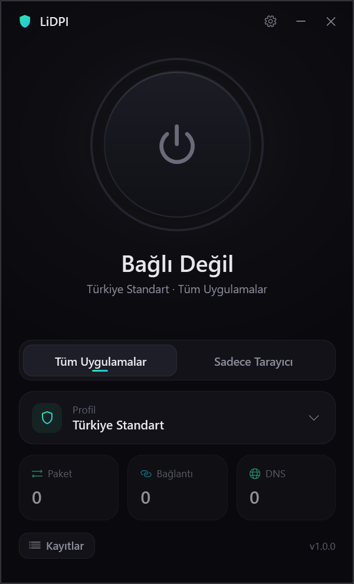
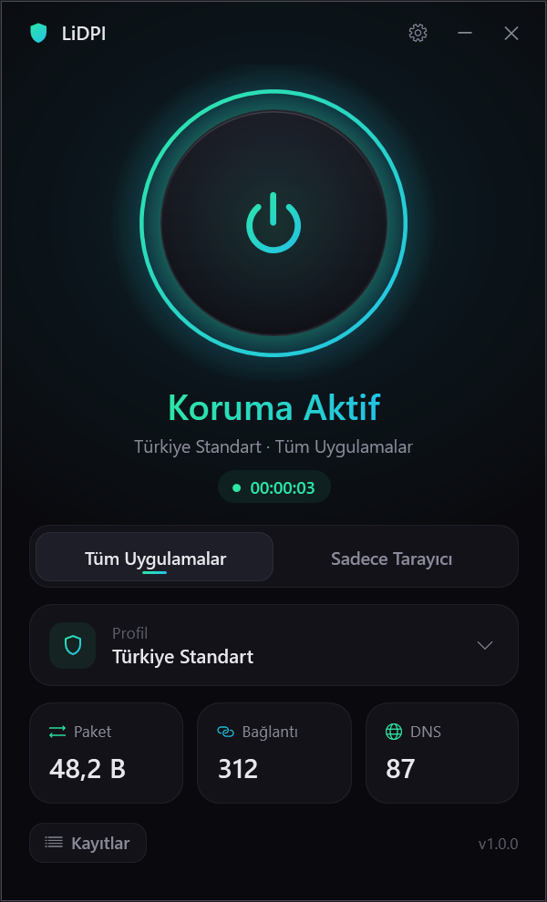
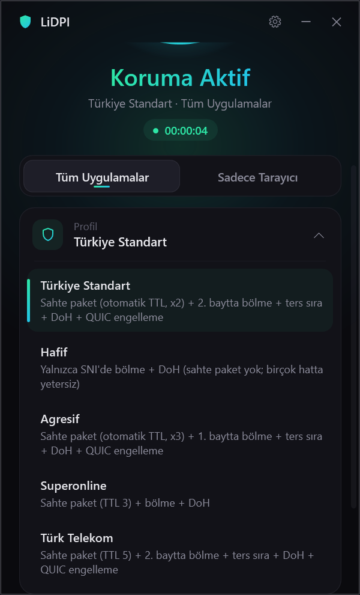
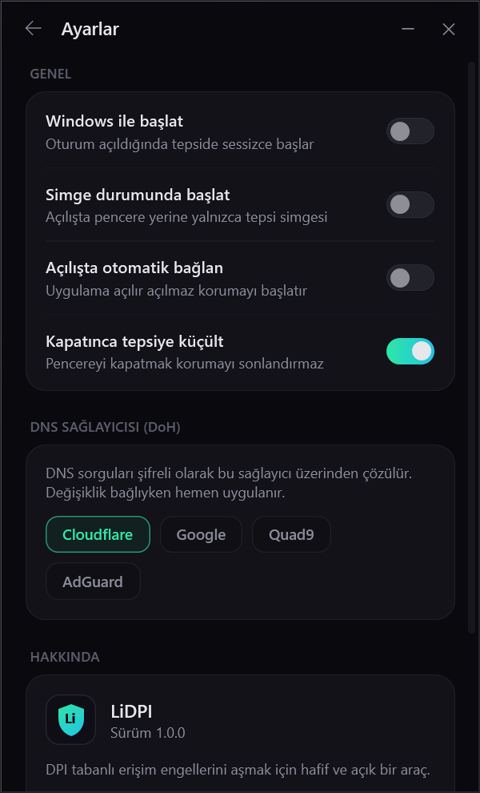

# LiDPI

**Tek tıkla DPI engellerini aşan, sürücülü ve sürücüsüz iki modlu, sade bir Windows uygulaması.**

[](https://github.com/LiebertDev/LiDPI/actions/workflows/build.yml)
[](https://github.com/LiebertDev/LiDPI/releases/latest)

**[⬇ LiDPI.exe indir (son sürüm)](https://github.com/LiebertDev/LiDPI/releases/latest)**

## Özellikler

- **Tek tıkla aç/kapat** — büyük bir düğmeyle korumayı başlatıp durdurun.
- **İki çalışma modu**
  - **Tüm Uygulamalar** — WinDivert tabanlı paket motoru; bilgisayardaki tüm uygulamaların trafiğine uygulanır.
  - **Sadece Tarayıcı** — sürücü gerektirmeyen yerel proxy; yalnızca tarayıcı trafiği için.
- **Hazır profiller** — Türkiye Standart, Hafif, Agresif, Superonline, Türk Telekom.
- **Şifreli DNS (DoH)** — Cloudflare, Google, Quad9 veya AdGuard üzerinden DNS over HTTPS.
- **Sistem tepsisi** desteği ve **Windows ile otomatik başlatma**.
- **Temiz durdurma** — kapatıldığında arkada çalışan süreç veya artık bırakmaz.

## Ekran Görüntüleri

| Durduruldu | Çalışıyor |
|---|---|
|  |  |

| Profiller | Ayarlar |
|---|---|
|  |  |

## Kurulum ve Kullanım

1. [Releases](https://github.com/LiebertDev/LiDPI/releases/latest) sayfasından en güncel `LiDPI.exe` dosyasını indirin (isterseniz yanındaki SHA256 değeriyle doğrulayın).
2. `LiDPI.exe`'yi çalıştırın. **Tüm Uygulamalar** modu WinDivert sürücüsünü yüklediği için yönetici izni ister.
3. Modu ve profili seçin, ardından düğmeye basın.
4. Bir site açılmazsa önce farklı bir profil (ör. **Agresif**) deneyin; ayarlardan şifreli DNS'i etkinleştirin.

Kurulum gerektirmez; tek bir `.exe` dosyasıdır. Sistemde .NET kurulu olması gerekmez.

## Nasıl Çalışır?

DPI (Derin Paket İnceleme) sistemleri, bağlantının hangi siteye gittiğini çoğunlukla TLS el sıkışmasındaki **SNI** alanından ve DNS sorgularından anlar. LiDPI bu tespiti zorlaştırmak için şu teknikleri kullanır:

- **TLS ClientHello SNI bölme** — ClientHello paketi, SNI alanı iki parçaya düşecek şekilde bölünerek gönderilir; basit DPI cihazları alan adını tek parçada göremez.
- **Düşük TTL'li sahte paket** — sunucuya ulaşmadan yolda düşecek kadar düşük TTL'ye sahip sahte bir paket gönderilir; DPI cihazı bunu gerçek trafik sanarak yanılır.
- **QUIC engelleme** — tarayıcıların UDP/443 (QUIC) denemeleri engellenir, böylece trafik yukarıdaki tekniklerin uygulanabildiği TCP/TLS'e düşer.
- **DNS over HTTPS** — DNS sorguları şifreli olarak DoH sağlayıcısına gönderilir; DNS tabanlı engelleme ve yönlendirme atlatılır.

**Tüm Uygulamalar** modu bu işlemleri WinDivert sürücüsüyle paket düzeyinde yapar. **Sadece Tarayıcı** modu ise yerel bir proxy üzerinden, sürücü yüklemeden benzer bölme tekniklerini uygular.

## Sıkça Sorulan Sorular

**Antivirüsüm LiDPI'yi zararlı olarak işaretliyor, neden?**
Tüm Uygulamalar modunun kullandığı WinDivert sürücüsü, ağ paketlerini yakalayabildiği için bazı antivirüs yazılımları (ör. Kaspersky, ESET) tarafından "riskli araç" olarak işaretlenebilir. Bu bir yanlış pozitiftir; WinDivert açık kaynaklıdır ve LiDPI'nin kaynak kodu da bu depodadır. İsterseniz sürücü gerektirmeyen **Sadece Tarayıcı** modunu kullanabilirsiniz.

**Başka bir DPI aracıyla birlikte çalışır mı?**
Hayır. Benzer araçlar aynı paketlere müdahale ettiği için çakışır. LiDPI'yi başlatmadan önce diğer DPI atlatma araçlarını kapatın ve varsa hizmetlerini durdurun.

**İnternetim yavaşladı mı?**
LiDPI yalnızca bağlantının ilk paketlerine müdahale eder; normal kullanımda belirgin bir hız farkı olmaz.

**Hangi Windows hesabıyla çalıştırmalıyım?**
LiDPI'yi kendi kullanıcı hesabınızdan (yönetici yetkisi alabilen bir hesap) çalıştırın. Yükseltme isteminde farklı bir yönetici hesabının bilgilerini girerseniz uygulama o hesap adına çalışır ve **Sadece Tarayıcı** modunun proxy ayarı sizin hesabınıza değil, o hesaba uygulanır.

**Kapattığımda bir şey kalıyor mu?**
Hayır. Durdurulduğunda sürücü ve proxy kapatılır, sistem ayarları eski hâline döner.

## Kaynaktan Derleme

Gereksinim: [.NET 9 SDK](https://dotnet.microsoft.com/download) (Windows).

```
dotnet publish src/LiDPI -c Release
```

Çıktı, tek dosyalık `LiDPI.exe` olarak `src/LiDPI/bin/Release/.../publish/` altında oluşur.

## Lisans

LiDPI [MIT lisansı](LICENSE) ile dağıtılır.

Üçüncü taraf bileşenler: **WinDivert** (LGPLv3 / GPLv2 çift lisanslı). Ayrıntılar için [THIRD_PARTY_NOTICES.md](THIRD_PARTY_NOTICES.md) dosyasına bakın.

## Sorumluluk Reddi

LiDPI, bilgiye erişim özgürlüğü ve gizliliğin korunması amacıyla geliştirilmiştir. Yazılım "olduğu gibi", hiçbir garanti olmaksızın sunulur. Kullanıcı, yazılımı kullanırken bulunduğu ülkenin yasalarına uymaktan kendisi sorumludur.

---

## English

**LiDPI** is a lightweight Windows app that bypasses DPI-based censorship with one click.

- Two modes: **All Apps** (WinDivert packet engine, system-wide) and **Browser Only** (local proxy, no driver).
- Built-in profiles tuned for Turkish ISPs, plus encrypted DNS (DoH via Cloudflare, Google, Quad9, AdGuard).
- Techniques: TLS ClientHello SNI splitting, low-TTL fake packets, QUIC blocking, DNS over HTTPS.
- Tray icon, autostart, clean stop with no leftover processes.

Download `LiDPI.exe` from [Releases](https://github.com/LiebertDev/LiDPI/releases/latest) and run it (All Apps mode requires administrator rights). Some antivirus products flag the open-source WinDivert driver; this is a false positive. Close other DPI tools before use. Build with `dotnet publish src/LiDPI -c Release`.

Licensed under MIT; WinDivert is LGPLv3/GPLv2 (see THIRD_PARTY_NOTICES.md). Intended for access to information and privacy; you are responsible for complying with your local laws.
